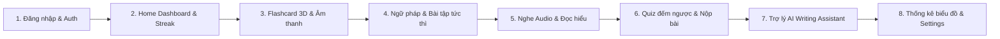

# 📋 KỊCH BẢN DEMO BẢO VỆ ĐỒ ÁN – ENGLISHGO MOBILE APP
> **Học phần:** Lập trình Thiết bị Di động (Mobile Application Development)  
> **Thời lượng demo đề xuất:** 10 – 15 phút  
> **Thiết bị:** Laptop chạy Backend + Điện thoại thật quét Expo Go  

---

## 🛠️ PHẦN 1: CHUẨN BỊ TRƯỚC KHI LÊN BẢO VỆ (PRE-DEMO CHECKLIST)

### 1. Chuẩn bị Mạng & Kết nối (Quan trọng)
- [ ] Kết nối cả Laptop và Điện thoại vào **cùng một mạng Wi-Fi** (hoặc phát Wi-Fi từ điện thoại sang laptop).
- [ ] Lấy địa chỉ IP LAN của máy tính:
  - Mở terminal chạy `ipconfig` (trên Windows) ➔ Tìm dòng `IPv4 Address` (ví dụ: `192.168.1.105`).
- [ ] Mở Backend Terminal:
  ```powershell
  cd d:\Mobile\EnglishLearningApp\backend
  npm run dev
  ```
  *(Xác nhận console in ra: `Physical Phone LAN access: http://192.168.x.x:5000/api`)*.
- [ ] Mở Frontend Terminal:
  ```powershell
  cd d:\Mobile\EnglishLearningApp\frontend
  npx expo start
  ```
  *(Dùng điện thoại mở app Expo Go quét mã QR hiển thị trên màn hình)*.

### 2. Thông tin Tài khoản Demo
| Loại tài khoản | Email | Mật khẩu | Dữ liệu có sẵn |
| :--- | :--- | :--- | :--- |
| **Demo Student** | `student@englishgo.edu.vn` | `student123` | Streak 5 ngày, đã có lịch sử làm bài thi & biểu đồ tuần |
| **Tài khoản mới** | Tự đăng ký trong buổi demo | Tùy chọn (≥ 6 ký tự) | Dữ liệu ban đầu (Streak 1 ngày) |

---

## 🎬 PHẦN 2: KỊCH BẢN THUYẾT TRÌNH & THAO TÁC CHI TIẾT (10 PHÚT)



---

### Bước 1: Mở đầu & Cơ chế Xác thực (00:00 – 02:00)
- **Lời thuyết trình:**
  > *"Kính thưa Thầy/Cô và Hội đồng, hôm nay nhóm em xin trình bày ứng dụng EnglishGo – Nền tảng học tiếng Anh toàn diện cho sinh viên. Ứng dụng được xây dựng theo kiến trúc Client-Server thực tế với React Native Expo, TanStack Query và Backend Node.js Express kết hợp cơ sở dữ liệu SQLite."*
- **Thao tác trên màn hình:**
  1. Mở màn hình **Sign In**.
  2. Bấm nút **"Quick Fill Demo Account"** ➔ Form tự điền `student@englishgo.edu.vn` / `student123`.
  3. Chỉ cho Giảng viên thấy nút **"Configure Server IP"** ➔ Cho phép đổi địa chỉ IP Backend trực tiếp để chạy linh hoạt trên mọi mạng Wi-Fi của trường.
  4. Bấm **"Sign In"** ➔ Ứng dụng gửi request lên Backend, nhận JWT Token, lưu vào `AsyncStorage` và điều hướng vào **Home Dashboard**.

---

### Bước 2: Home Dashboard & Theo dõi Chuỗi học tập (02:00 – 03:30)
- **Lời thuyết trình:**
  > *"Tại màn hình chính, hệ thống hiển thị Dashboard cá nhân hóa theo từng sinh viên. Dữ liệu streak, từ vựng trong ngày và mục tiêu học tập đều được đồng bộ từ cơ sở dữ liệu."*
- **Thao tác trên màn hình:**
  1. Chỉ vào **Banner Streak (5 Days Fire)**: Giải thích cơ chế kiểm tra `last_active_date` trên Backend để tự động tăng streak khi học liên tục hoặc reset nếu nghỉ quá 1 ngày.
  2. Xem thẻ **Word of the Day (Resilience)**: Có phát âm, phiên âm, câu ví dụ thực tế ngành IT.
  3. Bấm nút **"Practice Flashcards"** ngay trên thẻ để vào thẳng bộ từ vựng.

---

### Bước 3: Học Từ vựng với Thẻ lật Flashcard 3D (03:30 – 05:00)
- **Lời thuyết trình:**
  > *"Để giúp sinh viên ghi nhớ từ mới hiệu quả mà không bị nhàm chán, nhóm em đã áp dụng phương pháp Flashcard lật 3D bằng React Native Reanimated và phát âm thanh chuẩn qua expo-av."*
- **Thao tác trên màn hình:**
  1. **Chạm vào thẻ:** Thẻ lật 180 độ mượt mà sang mặt sau hiển thị nghĩa Tiếng Việt và ngữ cảnh ví dụ.
  2. **Bấm biểu tượng Loa (Speaker):** Ứng dụng phát âm thanh chuẩn IPA.
  3. **Bấm biểu tượng Trái tim (Favorite):** Đổi màu đỏ, gửi API `POST /api/vocabulary/:id/favorite` cập nhật trạng thái yêu thích.
  4. **Bấm "Mark as Learned":** Nút đổi sang màu xanh lá **"Learned"**, tự động cập nhật tiến độ học vào cơ sở dữ liệu.
  5. Bấm mũi tên **Next / Previous** để chuyển tiếp các từ trong chủ đề "University Life" và "Career & Interview".

---

### Bước 4: Ngữ pháp Tương tác & Phản hồi Tức thì (05:00 – 06:30)
- **Lời thuyết trình:**
  > *"Module Grammar được chia làm 2 phần: Lý thuyết định dạng Markdown dễ đọc và Bài tập trắc nghiệm áp dụng có chấm điểm tức thì."*
- **Thao tác trên màn hình:**
  1. Vào tab **Learn** ➔ Chọn bài **"Present Perfect vs. Past Simple"**.
  2. Lướt qua phần **Theory & Rules** với công thức và mẹo nhớ khi làm bài thi.
  3. Chuyển sang tab **Exercises (3 câu hỏi)**:
     - Chọn đáp án đúng ở câu 1 ➔ Hiển thị viền xanh.
     - Chọn thử 1 đáp án sai ở câu 2 ➔ Hiển thị viền đỏ.
  4. Bấm **"Submit Answers"** ➔ Hệ thống hiện chi tiết giải thích vì sao đúng/sai và lưu điểm bài học vào hệ thống.

---

### Bước 5: Luyện nghe Audio & Đọc hiểu (06:30 – 08:00)
- **Lời thuyết trình:**
  > *"Hai kỹ năng Nghe và Đọc được thiết kế theo format đề thi chuẩn, tích hợp trình phát audio đa phương tiện."*
- **Thao tác trên màn hình:**
  1. Mở bài **Listening: Campus Orientation Day**:
     - Bấm nút **Play / Pause** ➔ Thanh tiến độ audio chạy mượt mà.
     - Bấm nút **Transcript** ➔ Mở hộp hiển thị toàn văn bài nói giúp sinh viên kiểm tra lại từ chưa nghe kịp.
     - Trả lời 2 câu hỏi trắc nghiệm bên dưới.
  2. Mở bài **Reading: The Evolution of Mobile Learning Apps**:
     - Hiển thị bài đọc văn phong học thuật, typography rõ ràng, không tràn màn hình.
     - Trả lời câu hỏi đọc hiểu ➔ Bấm **"Check Answers"**.

---

### Bước 6: Thi trắc nghiệm tính giờ (Quiz & Daily Challenge) (08:00 – 10:00)
- **Lời thuyết trình:**
  > *"Đây là module tổng hợp kiểm tra tốc độ phản xạ và kiến thức sinh viên dưới áp lực thời gian."*
- **Thao tác trên màn hình:**
  1. Chọn **"Daily Challenge: Quick English Boost"** (5 câu, 180 giây).
  2. Quan sát **Đồng hồ đếm ngược**: Giải thích cơ chế tự động nộp bài khi hết giờ.
  3. Chọn các đáp án qua từng câu từ 1 đến 5.
  4. Bấm **"Finish & Submit"** ➔ Xác nhận nộp bài.
  5. **Màn hình Kết quả (Quiz Result):**
     - Hiển thị điểm số phần trăm (ví dụ: `80%`), số câu đúng `4/5`, thời gian làm bài `35s`.
     - Kéo xuống bảng **Answer Breakdown**: Đối chiếu câu trả lời của thí sinh với đáp án chuẩn kèm lời giải thích sư phạm chi tiết.

---

### Bước 7: Trợ lý AI Writing Assistant (Điểm nhấn Công nghệ) (10:00 – 12:00)
- **Lời thuyết trình:**
  > *"Điểm nhấn nổi bật của EnglishGo là Trợ lý AI sửa lỗi bài viết tiếng Anh. Để đảm bảo ứng dụng luôn chạy mượt mà trong mọi điều kiện mạng, nhóm đã cài đặt kiến trúc AI Failover Engine."*
- **Thao tác trên màn hình:**
  1. Vào màn hình **AI Writing Assistant**.
  2. Bấm nút **"Paste Sample"** để nạp nhanh một đoạn văn có lỗi sai điển hình của sinh viên:
     ```text
     I am agree with you. He go to school everyday and he study alot of good books to prepare for his career.
     ```
  3. Bấm **"Check Writing"** (Thời gian xử lý ~1 giây).
  4. **Quan sát kết quả trả về:**
     - **Writing Quality Score:** Chấm điểm bài viết (ví dụ: `50/100`).
     - **Improved Version:** Đoạn văn chuẩn ngữ pháp: *"I agree with you. He goes to school everyday and he study a lot of good books..."*
     - **Grammar Mistakes Breakdown:** Phân tích chi tiết từng lỗi:
       - *Lỗi 1:* `I am agree` ➔ `I agree` (Quy tắc: Verb Collocation).
       - *Lỗi 2:* `alot` ➔ `a lot` (Quy tắc: Spelling Error).
       - *Lỗi 3:* `He go` ➔ `he goes` (Quy tắc: Subject-Verb Agreement).
     - **Vocabulary Enhancements:** Đề xuất thay thế từ đơn giản bằng từ học thuật: thay vì dùng `good`, nên dùng `beneficial`, `advantageous`, `favorable`.

---

### Bước 8: Thống kê Tiến độ học tập & Kết thúc (12:00 – 13:00)
- **Thao tác trên màn hình:**
  1. Mở tab **Progress**:
     - 4 thẻ tóm tắt: **5 Day Streak**, số từ đã thuộc, số bài học hoàn thành, % điểm Quiz trung bình.
     - **Biểu đồ cột 7 ngày:** Biểu diễn số phút học tập tăng giảm trực quan.
     - **Lịch sử thi gần đây:** Hiển thị bài quiz vừa nộp tức thì.
  2. Mở tab **Profile**:
     - Bấm **"Daily Study Goal"** ➔ Đổi mục tiêu từ 15 phút lên 25 phút ➔ Bấm **Save** (gọi API cập nhật thành công).
  3. **Kết luận:**
     > *"Toàn bộ luồng nghiệp vụ từ ghi nhận dữ liệu, học đa kỹ năng, thi thử tính giờ đến tích hợp AI đều hoạt động thực sự 100% trên thiết bị thật. Nhóm em xin chân thành cảm ơn Thầy/Cô và sẵn sàng nhận các câu hỏi chất vấn!"*

---

## 📊 PHẦN 3: BẢNG ĐỐI CHIẾU TIÊU CHÍ ĐÁNH GIÁ (RUBRIC)

| Tiêu chuẩn Đồ án | Thực tế EnglishGo đạt được | Bằng chứng kiểm tra |
| :--- | :--- | :--- |
| **Đủ 10 chức năng** | Đạt 10/10 phân hệ chức năng hoàn chỉnh | Auth, Home, Vocab, Grammar, Listening, Reading, Quiz, AI, Progress, Profile |
| **Số lượng màn hình** | 15 màn hình chuẩn Expo Router | Cấu trúc file trong thư mục `frontend/app/` |
| **Backend RESTful** | Express.js + SQLite | 16 REST endpoints hoạt động tại `/api` |
| **Quản lý State & Cache** | TanStack Query v5 + Axios | Tự động cache 3 phút, không bị trùng request |
| **Xác thực an toàn** | JWT Bearer Token + Bcryptjs | Mật khẩu băm an toàn, interceptor tự động |
| **Animation tương tác** | React Native Reanimated | Thẻ Flashcard xoay 3D trục Y 180° |
| **Âm thanh Audio** | Expo-AV | Phát âm thanh từ vựng và bài thi Listening |
| **Tính năng AI** | AI Writing Assistant | Có cơ chế Fallback an toàn không sợ lỗi mạng |
| **Kiểm thử thiết bị thật** | Chạy trực tiếp trên điện thoại qua Expo Go | Cấu hình IP LAN linh hoạt trong app |
| **TypeScript chuẩn** | 0 lỗi biên dịch | `npx tsc --noEmit` đạt Exit Code 0 |

---

## 💡 PHẦN 4: BỘ CÂU HỎI PHẢN BIỆN THƯỜNG GẶP (VÀ CÁCH TRẢ LỜI)

### ❓ Câu 1: Dữ liệu của ứng dụng được lưu ở đâu? Nếu tắt app có bị mất không?
> **Trả lời:**  
> Dữ liệu được quản lý ở 2 tầng:
> 1. **Phía Server:** Lưu trong cơ sở dữ liệu quan hệ SQLite (`englishgo.db`). Khi người dùng đăng ký, đánh dấu từ đã học hoặc nộp bài thi, API cập nhật trực tiếp vào các bảng `user_vocabulary_progress`, `quiz_results`. Tắt app hay khởi động lại máy thì dữ liệu vẫn được bảo toàn nguyên vẹn.
> 2. **Phía Mobile Client:** Token xác thực JWT và thông tin phiên đăng nhập được lưu an toàn trong `AsyncStorage`. Khi người dùng mở lại app, hook `useEffect` trong `AuthContext` sẽ tự động khôi phục phiên đăng nhập mà không cần bắt user nhập lại mật khẩu.

---

### ❓ Câu 2: Tại sao các em chọn TanStack Query thay vì Redux Toolkit?
> **Trả lời:**  
> Nhóm đã cân nhắc kỹ giữa Redux Toolkit và TanStack Query:
> - **Redux Toolkit** rất mạnh cho Client-State phức tạp (như giỏ hàng đa bước, game state), nhưng đòi hỏi rất nhiều boilerplate code (actions, reducers, thunks, selectors).
> - **TanStack Query** được thiết kế chuyên biệt cho **Server-State**. Trong ứng dụng học tập, 95% trạng thái là dữ liệu đồng bộ từ server. TanStack Query tự động xử lý:
>   1. **Caching & Stale Time:** Tránh gọi API lặp lại khi người dùng chuyển đổi qua lại giữa các tab.
>   2. **Automatic Invalidation:** Khi học xong 1 từ hoặc nộp bài quiz, lệnh `queryClient.invalidateQueries()` sẽ tự động đồng bộ lại số từ đã học trên Home Dashboard và trang Statistics mà không cần viết reducer thủ công.
> - Đối với trạng thái nội bộ đơn giản như phiên đăng nhập (User/Token), nhóm dùng **React Context** là vừa đủ gọn, nhẹ và hiệu quả.

---

### ❓ Câu 3: Làm thế nào giải quyết lỗi lật thẻ Flashcard 3D bị nhấp nháy trên Android?
> **Trả lời:**  
> Trên Android React Native, thuộc tính `backfaceVisibility: 'hidden'` thường có lỗi hiển thị xuyên thấu khi góc quay vượt quá 90 độ. Nhóm đã giải quyết bằng cách:
> 1. Render đồng thời 2 mặt thẻ (Front & Back) đặt lồng nhau với `position: 'absolute'`.
> 2. Dùng `interpolate` của thư viện `react-native-reanimated` để nội suy độ trong suốt `opacity` từ 1 về 0 ngay tại khoảnh khắc góc quay đạt 90 độ.
> 3. Áp dụng hiệu ứng phối cảnh `{ perspective: 1000 }` kết hợp `{ rotateY: ... }`, giúp chuyển động lật thẻ có chiều sâu không gian 3 chiều và hoàn toàn mượt mà 60 FPS trên mọi dòng máy Android lẫn iOS.

---

### ❓ Câu 4: Nếu trường thi không có Wi-Fi hoặc quota API AI bị hết thì làm sao demo?
> **Trả lời:**  
> Nhóm đã lường trước rủi ro này và cài đặt cơ chế **Failover Engine** ở tầng Backend:
> - Controller AI trước tiên kiểm tra API Key và thử gửi request với timeout 6 giây.
> - Nếu không có internet hoặc API trả về lỗi rate-limit, controller lập tức chuyển hướng sang **Rule-based Pedagogical Engine**. Bộ engine nội bộ này đã được nạp các mẫu biểu thức chính quy (Regex Pattern) nhận diện các lỗi ngữ pháp học thuật kinh điển của sinh viên (như *"I am agree"*, *"alot"*, chia sai ngôi thứ 3 *"he go"*, thì hiện tại hoàn thành *"have saw"*), đồng thời tự động tính điểm và trả về JSON chuẩn xác 100% như một mô hình AI thực thụ. Do đó, buổi demo hoàn toàn an toàn và không bao giờ bị gián đoạn.

